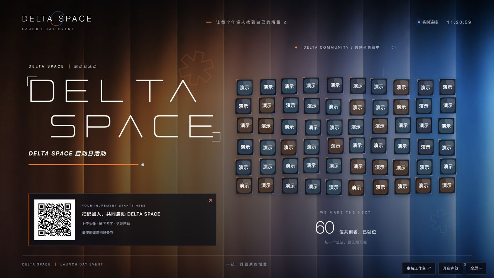

# DELTA SPACE · 启动活动互动系统

一套可在活动现场运行的互动启动系统：嘉宾手机扫码，填写昵称、上传头像，头像实时出现在大屏上；主持人在控制台发起倒计时，触发头像汇聚和主题揭幕。

项目参考了“全场扫码参与启动”的交互方式。嘉宾头像由本人选择上传，系统不会自动读取微信昵称或头像。

页面依据用户提供的 `底图.pdf` 与 `电梯厅.png` 统一品牌视觉：黑色底面、橙蓝折页与光束、白色窄体 `DELTA SPACE` 字样和星芒。大屏、手机参与页与主持控制台采用同一套品牌语言，保留物料中的“让每个年轻人找到自己的增量 △”。控制台可选择“橙蓝 · 主视觉”“暖橙 · 聚力”“深蓝 · 共创”三种气氛，见[视觉说明](docs/视觉说明.md)。

首次使用空数据目录时，默认主题为“DELTA SPACE”，副标题为“DELTA SPACE 启动日活动”，揭幕文字为“正式启动”。这些文案和活动 Logo 均可在主持控制台配置。品牌主视觉来自用户提供的实际物料；“签到处 / CHECK IN”仅用于对应导视，不作为全局活动标题。物料中的日期和场地也不写成不可修改的产品常量。升级会保留自定义配置；仅完整匹配历史出厂默认组合的文案会更新，规则见[视觉说明](docs/视觉说明.md)。

## 快速开始

需要 Node.js 22.9 或更新版本，推荐 Node.js 24 LTS。

**macOS 推荐：双击 [`启动.command`](启动.command)。** 脚本会在首次运行时自动安装缺少的依赖，创建本机 `.env`，生成并保存一条固定的随机主持口令，默认使用 `3188` 端口，并自动打开控制台。口令首次显示在终端，此后保存在 `.env` 中；在终端按 `Control + C` 停止服务。已有 `.env` 时沿用其中的端口和口令。

也可以在终端手动配置运行（以下 `.env.example` 默认端口为 `3000`；若已有 `.env`，不要覆盖它）：

```bash
npm install
cp .env.example .env
```

编辑 `.env`，为 `ADMIN_PASSWORD` 设置一条独立的主持口令，然后启动：

```bash
npm start
```

在运行电脑上打开：

| 页面 | 地址 | 用途 |
| --- | --- | --- |
| 主持控制台 | `http://localhost:3000/admin.html` | 配置活动、获取二维码、发起启动 |
| 活动大屏 | `http://localhost:3000/stage.html` | 连接 LED 屏或投影，浏览器全屏播放 |
| 手机参与页 | 从控制台复制链接或扫码 | 嘉宾填写昵称、上传头像并入场 |

如果端口已修改，请使用终端打印的地址。未设置主持口令时，每次启动会生成新的随机口令并显示在终端；正式活动前建议在 `.env` 中固定口令。服务重启后，控制台需要重新登录。

**手机无法访问电脑的 `localhost`。** 局域网使用时，手机和电脑连接同一网络，并使用控制台给出的局域网链接。跨网络参与请部署到有 HTTPS 域名的服务器，再设置 `PUBLIC_URL`，详见部署指南。

## 已实现的功能

- 手机端：昵称、头像选择与压缩、默认头像、参与同意、入场结果、本人资料修改。
- 大屏端：实时头像、参与人数、入场二维码、头像汇聚、倒计时、启动揭幕，以及可手动开启的合成声效。
- 主持端：口令登录、活动文案、主题、Logo、倒计时秒数、发起启动、复位、清空场次、演示嘉宾与嘉宾移除。
- 大屏与主持同步：使用 SSE 推送状态，断线后自动重连，以服务器时间计算倒计时。
- 手机状态：每 2 秒获取轻量状态，只接收本人资料和全局人数，减少大量手机同时在线的传输开销。
- 状态保留：本地数据文件持久化，刷新页面或重启服务后恢复当前场次。

默认参与上限为 1000 人；大屏同时展示最多 180 个头像，超出时轮换显示。这是软件配置上限，不是已验证的现场容量承诺；请使用活动实际的网络、电脑、屏幕和参与规模彩排。

独立演示预览可运行 `node scripts/preview.mjs`，默认仅监听本机 `http://localhost:3188`，口令为 `preview-ceremony-only`，数据保存在 `.preview-data/`，与正式 `data/` 隔离。此固定口令只用于本机预览；正式活动请使用 `启动.command` 或自行配置 `.env`。预览和正式服务使用相同端口时只能运行一个，也可通过 `PREVIEW_PORT` 改变预览端口。

## 推荐使用顺序

1. 在控制台设置活动标题、副标题、启动文案、Logo 和主题。
2. 打开大屏，添加演示嘉宾检查视觉效果，完整演练倒计时与揭幕。
3. 清空演示场次，重新获取入场二维码，在正式活动网络下用两部手机试扫。
4. 开放现场入场；主持人确认后点击开始倒计时。倒计时开始后停止新入场。
5. 活动结束后按现场手册清理参与资料。

### 本机控制台与扩展屏

在本机打开控制台，点击「打开大屏」，将新窗口拖到扩展屏后按 `F` 全屏。展示页以统一画布等比缩放，适配常规横屏、16:10 和 21:9；超出支持比例时居中留边，避免内容拉伸或裁切。4K 屏上的文字、头像、二维码和动画会一起放大。

控制台「大屏显示调节」可以实时调整二维码大小和顶部位置。推荐值为画面高度的 26% 和距顶部 54%，比原布局更大、更靠上。拖动滑块后自动保存并同步到所有已打开的大屏，无需刷新；系统会自动避让标题和底边，空间不足时限制大小或位置。点击「恢复推荐比例」可还原显示设置。

## 文档

- [部署指南](docs/部署指南.md)：局域网、公网 HTTPS、反向代理、进程常驻。
- [现场操作手册](docs/现场操作手册.md)：彩排、正式流程、常见故障和收场。
- [技术说明](docs/技术说明.md)：目录、接口、状态机、数据和扩展边界。
- [验收记录](docs/验收记录.md)：已验证的流程、效果截图与现场待测项。
- [视觉说明](docs/视觉说明.md)：实际品牌物料、三种主题和资源使用方式。



## 开发验证

```bash
npm test
```

接口测试与浏览器验收侧重点不同。现场仍需检查手机浏览器上传、二维码可达性、大屏分辨率、连接中断恢复和启动节奏。

## 使用边界

当前版本适合单活动、单服务进程运行。大屏和入场链接可被拿到链接的人访问，主持控制台使用独立口令保护。当前未接入微信 OAuth、自动头像授权、多实例共享数据库、头像人工审核或商业活动平台的账号体系。需要这些能力时，应先扩展相应服务，再用于对应场景。
