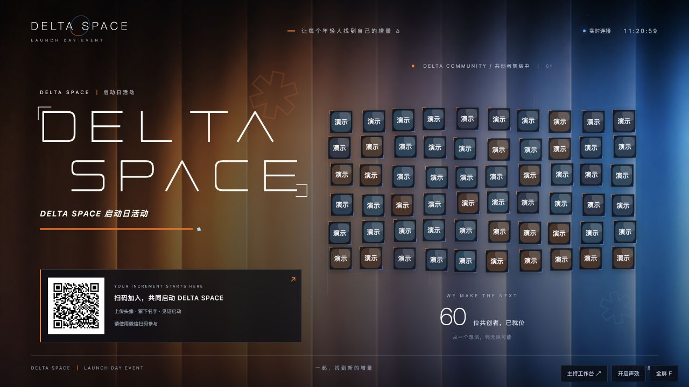
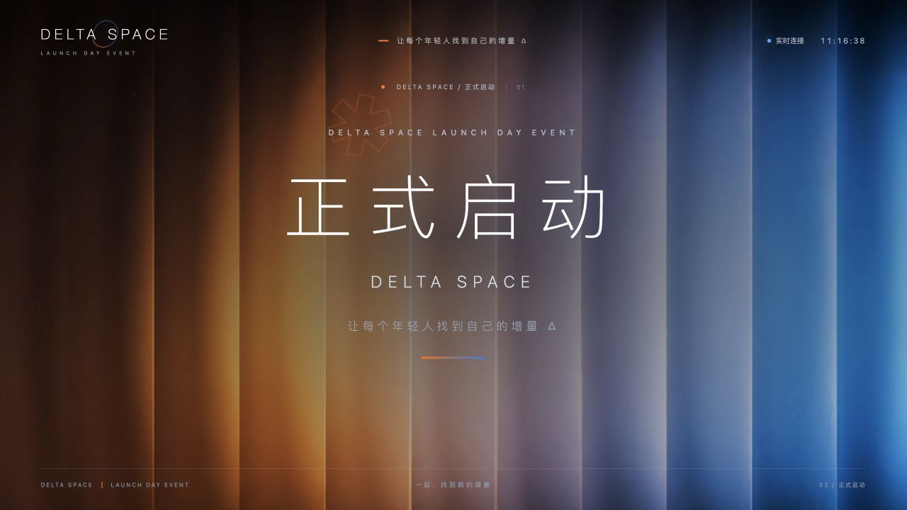
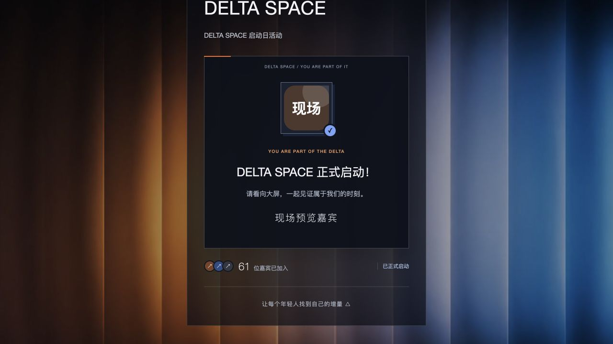

# 开发验收记录

验收日期：2026 年 10 月 30 日。

视觉已于同日按主办方实际活动物料统一为黑底橙蓝版：从提供的 PDF 提取无字底图，参考海报的几何大字、星芒及“让每个年轻人找到自己的增量 △”。默认文案为“DELTA SPACE”“DELTA SPACE 启动日活动”“正式启动”，保留自定义配置，仅历史出厂默认完整匹配时更新。先前印象派素材仅为历史探索，不代表当前视觉。

## 已完成的验证

- `npm test`：`tests/server.test.js` 的 12 个后端集成测试用例全部通过（2026 年 11 月 2 日复跑），覆盖加入与资料修改、图片校验、主持鉴权、跨站请求拒绝、二维码、SSE、大屏显示调节、统一倒计时、服务重启恢复、清空场次隔离、容量和限频、同一网络多人加入、写盘失败回滚、可信代理下的安全 Cookie、手机状态只返回本人资料，以及旧出厂默认文案迁移与自定义配置保留。
- `npm run check`：服务端、所有网页脚本与启动脚本语法检查通过。
- 浏览器：主持口令登录、60 位演示嘉宾上屏、手机参与页填写昵称并加入、人数从 60 更新至 61。
- 浏览器：主持确认启动后，大屏显示“正式启动”；参与页返回/刷新后恢复本人记录并显示“DELTA SPACE 正式启动！”。
- 浏览器：清空并新建场次后，人数归零，参与页可重新加入；演示数据与正式数据使用不同目录。
- 页面视觉：已检查 1280×720 横屏大屏与参与页桌面预览；二维码可生成并加载，页面无脚本错误。手机实际窄屏和相册仍需现场设备验收。

图片上传接口已通过真实 PNG 数据的集成测试。内嵌浏览器的文件选择自动化未能打开文件选择器，另一浏览器扩展未开启本地文件访问权限，因此手机相册选图、图片裁切效果仍需在目标手机上实测。

## 需要现场完成的验证

1. 用真实手机连接实际会场网络，扫描控制台的二维码；本机隔离预览的二维码不供会场使用。
2. 上传照片并确认头像、昵称上屏；重复打开同一场次应显示本人已加入状态。
3. 在实际 LED 屏分辨率下检查标题、二维码、头像和揭幕。
4. 断网并恢复、刷新页面、重启服务，检查场次与倒计时恢复。
5. 按实际规模进行负载和彩排。1000 人是默认配置上限，尚未做 1000 台真实手机的现场并发测试。
6. 正式活动前清空演示场次，再展示更新后的二维码。

## 效果截图

